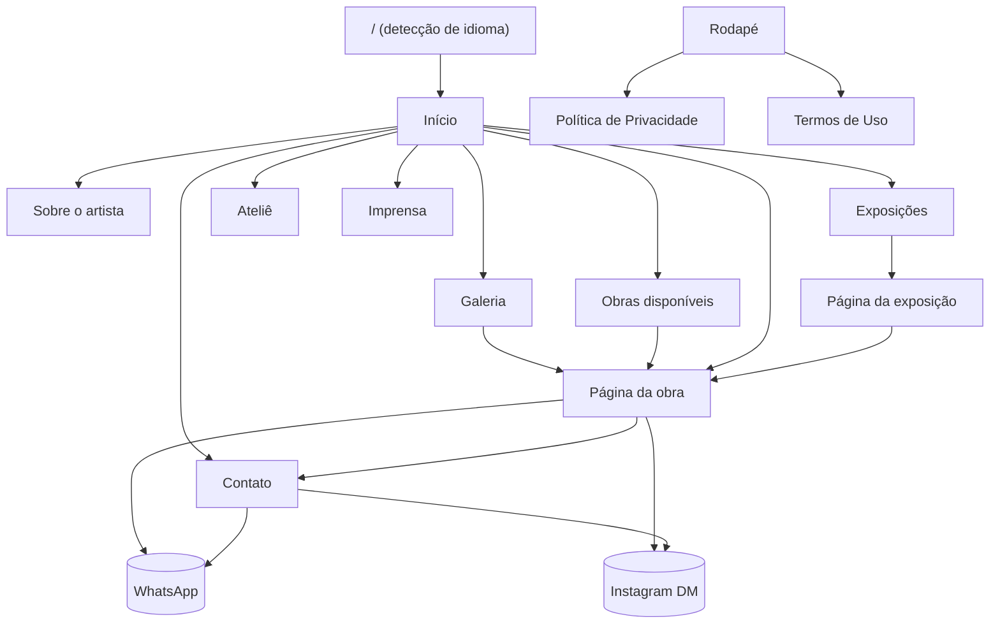
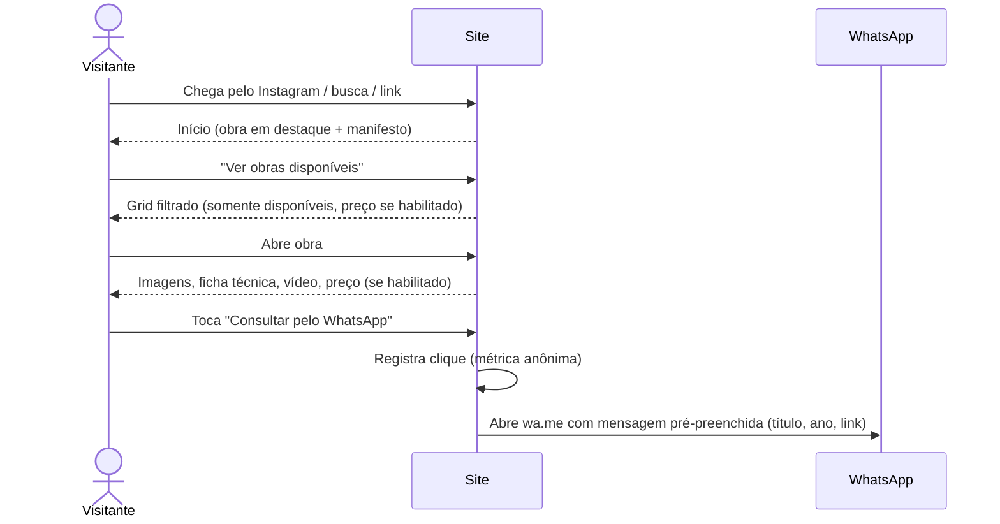

# 1. Resumo do conceito do produto

## 1.1 Visão

A plataforma de **Taigo Meireles** funciona como uma **galeria contemporânea digital**: um espaço silencioso, editorial e de alto padrão, em que a obra ocupa o centro da tela e todo o resto (texto, navegação, interface) se recolhe para não competir com ela.

Ela tem dois produtos:

| Produto | Público | Propósito |
|---|---|---|
| **Site público** (Angular) | Colecionadores, compradores de arte para casa, curadores, imprensa | Apresentar o artista, o ateliê e as obras; gerar consultas e contatos diretos |
| **Painel administrativo** (Angular) | Administradores (equipe do artista) | Publicar e manter todo o conteúdo, traduções, SEO, contatos e acompanhar métricas |

Os dois consomem uma **API REST em Laravel** (arquitetura headless), com dados em **MySQL** e arquivos de mídia no servidor da **Hostinger**.

## 1.2 Princípios de experiência

1. **A obra primeiro.** Imagens grandes, sem cortes que alterem a composição da obra, sem marca d'água, fundo neutro.
2. **Silêncio visual.** Muito espaço em branco, poucos elementos por tela, uma ação principal por contexto.
3. **Ritmo editorial.** Composições assimétricas inspiradas em catálogos de exposição: texto curto em Cinzel, legendas em Open Sans, alternância entre imagem cheia e blocos de texto.
4. **Consulta sem atrito.** Toda obra tem um caminho de no máximo um toque para WhatsApp, Instagram ou formulário, com a referência da obra já embutida na mensagem.
5. **Trilíngue de verdade.** PT, EN e ES com URLs, SEO e moeda próprios; tradução automática como ponto de partida, revisão manual como acabamento.
6. **Publicação direta.** No painel, salvar = publicar. Sem rascunho, prévia, auditoria ou 2FA (fora do escopo por decisão do cliente).

## 1.3 Escopo da versão 1

**Dentro:** site institucional e catálogo trilíngue; galeria com busca e filtros; página "Obras disponíveis"; página de obra com zoom, tela cheia e vídeo do YouTube; exposições; ateliê; imprensa; contato (WhatsApp, Instagram e formulário com resposta automática); Política de Privacidade; Termos de Uso; painel completo; dashboard de métricas.

**Fora (não modelar, não desenhar):** checkout, pagamento online, pedidos, contas de clientes, área de colecionadores, newsletter e campanhas, banner de cookies, 2FA, auditoria, rascunho/prévia, CDN obrigatória.

---

# 2. Mapa do site e fluxos principais do visitante

## 2.1 Estrutura de URLs (sugestão)

Cada idioma tem um prefixo e slugs traduzidos. A raiz `/` só faz a detecção de idioma e redireciona.

| Página | PT (`/pt`) | EN (`/en`) | ES (`/es`) |
|---|---|---|---|
| Início | `/pt` | `/en` | `/es` |
| Sobre o artista | `/pt/sobre` | `/en/about` | `/es/sobre` |
| Galeria | `/pt/galeria` | `/en/gallery` | `/es/galeria` |
| Obras disponíveis | `/pt/obras-disponiveis` | `/en/available-works` | `/es/obras-disponibles` |
| Obra | `/pt/obras/{slug-pt}` | `/en/works/{slug-en}` | `/es/obras/{slug-es}` |
| Exposições | `/pt/exposicoes` | `/en/exhibitions` | `/es/exposiciones` |
| Exposição | `/pt/exposicoes/{slug}` | `/en/exhibitions/{slug}` | `/es/exposiciones/{slug}` |
| Ateliê | `/pt/atelie` | `/en/studio` | `/es/taller` |
| Imprensa | `/pt/imprensa` | `/en/press` | `/es/prensa` |
| Contato | `/pt/contato` | `/en/contact` | `/es/contacto` |
| Política de Privacidade | `/pt/privacidade` | `/en/privacy` | `/es/privacidad` |
| Termos de Uso | `/pt/termos` | `/en/terms` | `/es/terminos` |

Os segmentos fixos (`galeria`, `gallery`...) são definidos no front; os slugs de conteúdo (`{slug}`) vêm do banco e são editáveis por idioma.

## 2.2 Mapa do site

**Navegação principal (cabeçalho):** Sobre · Galeria · Disponíveis · Exposições · Ateliê · Imprensa · Contato · seletor `PT | EN | ES`.
O logotipo/assinatura "TAIGO MEIRELES" (Cinzel) leva ao Início.

**Rodapé:** assinatura, frase curta, navegação secundária, WhatsApp, Instagram, e-mail público (se configurado), seletor de idioma, Política de Privacidade, Termos de Uso, © ano.

## 2.3 Regras de idioma

1. Visitante acessa `/` → o front lê `navigator.languages` em ordem:
   - `pt*` → `/pt`; `es*` → `/es`; `en*` → `/en`; nenhum dos três → **`/en`**.
2. Se o visitante já escolheu manualmente um idioma, a escolha é lembrada no `localStorage` do navegador (preferência funcional, sem rastreamento) e tem prioridade sobre a detecção.
3. Links diretos (`/es/obras/...`) **nunca** são redirecionados: a URL manda.
4. O seletor de idioma leva para a **página equivalente** no outro idioma (mesma obra, com o slug traduzido), não para o Início.
5. Conteúdo com tradução automática é exibido normalmente (sem selo para o visitante — ver ponto a confirmar P-12).
6. Moeda: `pt` → **R$** (`R$ 12.000`); `en` e `es` → **US$** (`US$ 2,400` / `US$ 2.400`).

## 2.4 Fluxos principais

### F1 — Colecionador descobre e consulta uma obra

### F2 — Pessoa que compra para casa navega pela galeria
Início → Galeria → busca por nome ou filtra (técnica, série, ano, disponibilidade) → abre obra → amplia imagem em tela cheia → vê que está **reservada** → é convidada a "Ver obras disponíveis semelhantes" (mesma série/técnica) ou "Falar com o ateliê".

### F3 — Curador/imprensa
Início → Sobre (biografia, trajetória, fotos em alta) → Exposições (passadas) → Imprensa (PDFs, entrevistas) → Contato pelo formulário → recebe confirmação automática no idioma do site.

### F4 — Contato pelo formulário
Contato → preenche nome, e-mail, telefone, mensagem → envia → estado de carregamento no botão → **tela de sucesso** no lugar do formulário ("Mensagem recebida. Responderemos em breve.") → e-mail de confirmação automática ao visitante + notificação ao e-mail destinatário + mensagem na caixa de entrada do painel.
Se o formulário for iniciado a partir de uma obra ("Consultar por e-mail"), o campo mensagem já vem com a referência da obra e a mensagem fica vinculada a ela no painel.

### F5 — Troca de idioma
Em qualquer página → `EN` → navega para a rota equivalente em inglês, preserva filtros da galeria (query string) e posição de rolagem quando possível.

## 2.5 Fluxos principais do administrador

| Fluxo | Passos |
|---|---|
| A1 Entrar | Login (e-mail + senha) → Dashboard |
| A2 Recuperar senha | "Esqueci a senha" → e-mail → link com token (validade limitada) → nova senha → login |
| A3 Cadastrar obra | Obras → Nova → dados (PT) → imagens (upload, arrastar para ordenar, marcar principal) → vídeo YouTube → preços R$/US$ + exibir preço → Salvar (publica) → traduções EN/ES geradas automaticamente → revisar traduções e SEO |
| A4 Mudar status | Lista de obras → menu de status → Disponível / Reservada / Vendida (efeito imediato no site) |
| A5 Responder mensagem | Mensagens → abrir (marca como lida) → "Responder por e-mail" (abre cliente de e-mail) / "Abrir WhatsApp" se houver telefone → marcar como não lida ou excluir |
| A6 Revisar traduções | Traduções → filtro "Automáticas" → editar → salvar (vira "Revisada manualmente") |
| A7 Ajustar contatos | Configurações → Contato → WhatsApp, Instagram, e-mail destinatário → Salvar |
