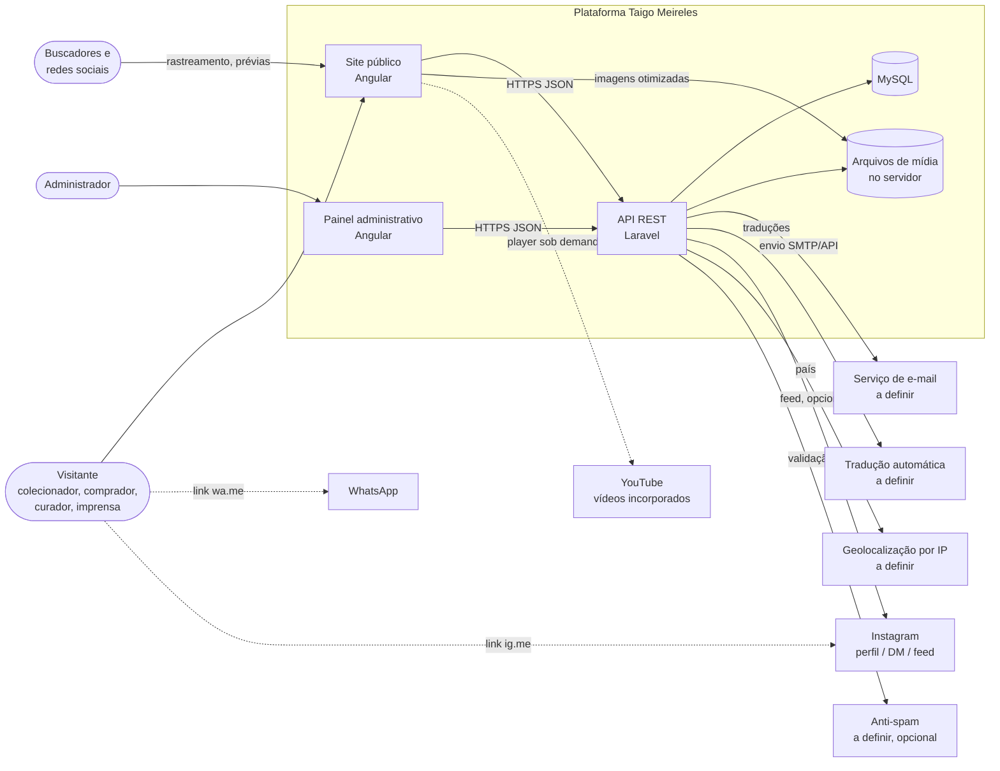
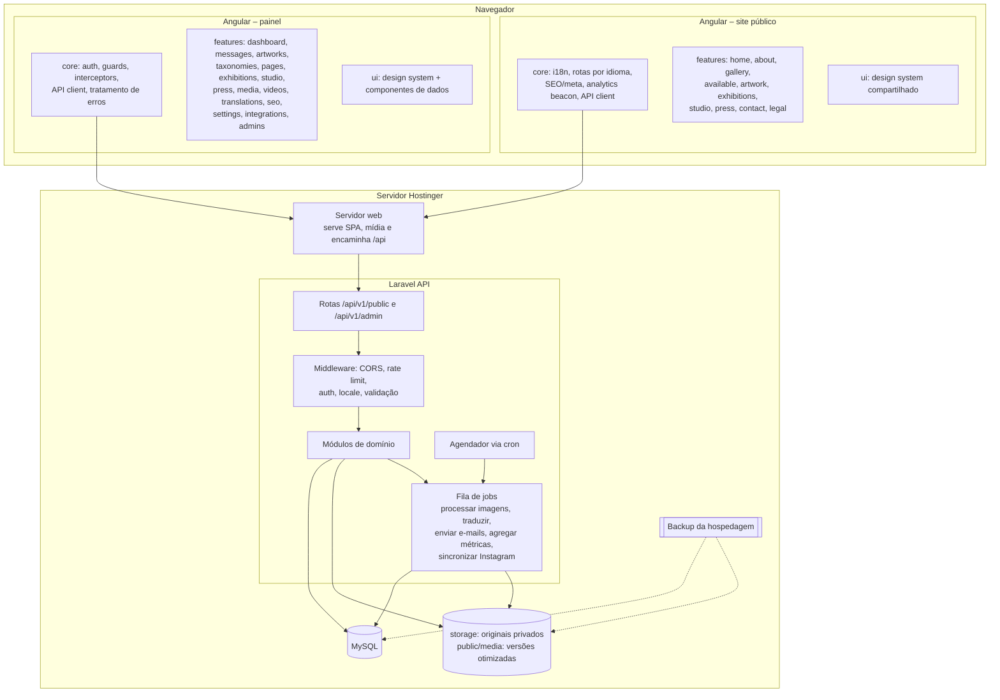
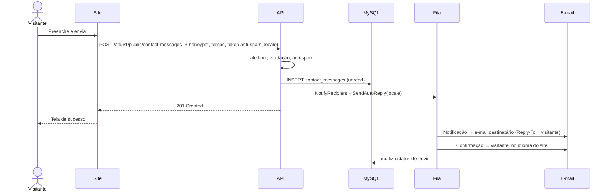
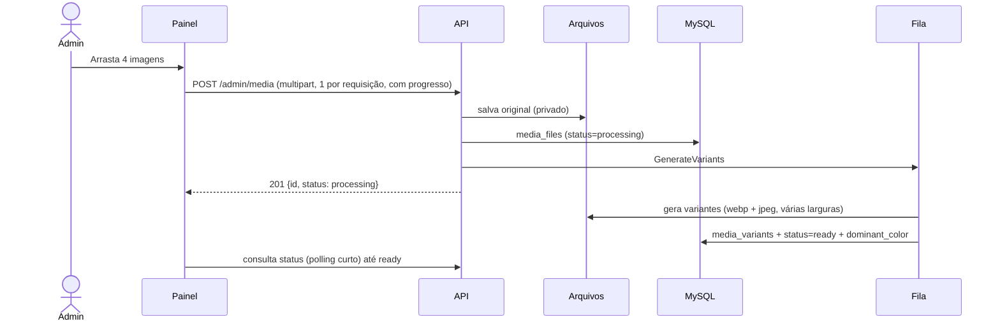

# 6. Arquitetura de software e tecnologia

**Definido pelo cliente:** Angular (site e painel), Laravel com API REST, MySQL, Hostinger, headless, imagens em arquivos no servidor (banco guarda caminhos e metadados), backup do serviço da hospedagem, vídeos do YouTube incorporados.
**Tudo o que estiver marcado como _Sugestão_ é recomendação a confirmar.** Versões de Angular, Laravel, MySQL e PHP são decisão pendente (P-01): usar as versões estáveis com suporte ativo no momento da implementação, verificando a compatibilidade entre si e com o plano da Hostinger (versão de PHP disponível, MySQL 8.x ou MariaDB).

## 6.1 Diagrama de contexto



## 6.2 Diagrama de componentes



## 6.3 Organização dos módulos

### Frontend — workspace Angular (Sugestão: um workspace com dois apps e bibliotecas compartilhadas)
```
frontend/
  projects/
    site/                     app público
      src/app/
        core/                 i18n (resolução de idioma, rotas traduzidas), seo (meta, OG, hreflang, JSON-LD),
                              analytics (beacon de eventos), api (clientes HTTP), errors
        layout/               header, footer, mobile-menu, language-switcher
        features/
          home/ about/ gallery/ available/ artwork/ exhibitions/
          studio/ press/ contact/ legal/ not-found/
    admin/                    painel
      src/app/
        core/                 auth (sessão, guards), http (interceptors, erros 401/419/422), notifications
        layout/               shell, sidebar, topbar
        features/
          auth/ dashboard/ messages/ artworks/ taxonomies/ pages/ exhibitions/
          studio/ press/ media/ videos/ translations/ seo/ settings/ integrations/ admins/ account/
    ui/                       biblioteca: tokens, tipografia, botões, formulários, cards, feedback, viewer
    api-models/               biblioteca: interfaces TypeScript dos contratos da API
```
- Componentes standalone, carregamento sob demanda por feature (lazy routes).
- Estado: serviços com sinais/observables por feature; sem biblioteca global de estado na V1 (Sugestão — o volume não justifica).
- i18n da interface (rótulos fixos): biblioteca de tradução em tempo de execução **ou** i18n nativo do Angular com um build por idioma — decisão pendente P-13. _Sugestão:_ tempo de execução, porque o idioma troca sem recarregar e os textos podem vir da API (editáveis no painel).

### Backend — Laravel (Sugestão: organização modular por domínio)
```
backend/app/
  Domain/
    Auth/            login, logout, reset de senha, convites
    Admins/          gestão de administradores
    Catalog/         Artwork, Category, Technique, Series, preços, status
    Media/           upload, MediaFile, MediaVariant, processamento, documentos PDF
    Videos/          YouTubeVideo (validação de URL/ID)
    Content/         Page, PageSection, Exhibition, StudioItem, PressItem
    Localization/    Locale, traduções, status (auto/manual), provedor de tradução, slugs
    Seo/             metadados por idioma, sitemap, meta para robôs
    Contact/         ContactMessage, anti-spam, notificação, resposta automática
    Settings/        configurações do site, contato, respostas automáticas
    Analytics/       coleta de eventos, hash diário, agregação, consultas do dashboard
    Integrations/    Instagram, e-mail, geolocalização, anti-spam (adaptadores por interface)
  Http/
    Controllers/Public/   somente leitura + contato + eventos
    Controllers/Admin/    CRUD autenticado
    Requests/             validação
    Resources/            transformação JSON (inclui resolução de idioma e moeda)
  Jobs/  Mail/  Policies/  Console/ (comandos agendados)
```
- Cada integração externa atrás de uma **interface** (ex.: `TranslationProvider`, `GeoIpResolver`, `SpamGuard`, `InstagramFeedSource`), permitindo trocar de fornecedor sem afetar o domínio.

## 6.4 Fluxos entre visitante, apps, API, banco e armazenamento

### Leitura de uma obra
```mermaid
sequenceDiagram
  actor V as Visitante
  participant W as Servidor web
  participant S as Site Angular
  participant API as API Laravel
  participant DB as MySQL
  participant FS as Mídia
  V->>W: GET /pt/obras/horizonte-ii
  W-->>V: HTML (com meta SEO — ver §6.9) + JS
  S->>API: GET /api/v1/public/artworks/horizonte-ii?locale=pt-BR
  API->>DB: obra + tradução pt-BR (fallback origem) + imagens + variantes
  API-->>S: JSON (preço só se regra permitir; URLs das variantes)
  S->>FS: GET /media/ab/abcd…/w1600.webp (srcset)
  S->>API: POST /api/v1/public/analytics/events (artwork_view)
```

### Envio do formulário de contato


### Upload de imagem no painel


## 6.5 Rotas da API REST por domínio (proposta, sem implementação)
Prefixo versionado `/api/v1`. Público em `/public`, administrativo em `/admin`. JSON, paginação `?page=&per_page=`, erros no formato `{message, errors{campo:[...]}}`. Idioma no público por `?locale=pt-BR|en|es` (ou cabeçalho `Accept-Language` como alternativa).

### Público (sem autenticação, cache HTTP curto onde indicado)
| Domínio | Método e rota | Observação |
|---|---|---|
| Site | `GET /public/site` | Configurações públicas: idiomas, contato (WhatsApp, Instagram, e-mail público), textos globais, redes. Cache |
| Páginas | `GET /public/pages/{key}` | `home`, `about`, `gallery`, `available`, `exhibitions`, `studio`, `press`, `contact`, `privacy`, `terms`; inclui seções e SEO |
| Início | `GET /public/home` | Agregado: destaque, manifesto, recentes, exposições, ateliê, flags |
| Catálogo | `GET /public/artworks` | `q, category, technique, series, year, status, sort, page` |
| | `GET /public/artworks/available` | Somente `available` |
| | `GET /public/artworks/{slug}` | Slug do idioma; resposta inclui slugs dos outros idiomas (para o seletor) |
| | `GET /public/artworks/{slug}/related` | Mesma série/técnica |
| | `GET /public/filters` | Categorias, técnicas, séries e anos com contagem |
| Exposições | `GET /public/exhibitions?when=current\|upcoming\|past` | |
| | `GET /public/exhibitions/{slug}` | |
| Ateliê | `GET /public/studio-items?theme=` | |
| Imprensa | `GET /public/press-items?type=` | |
| Instagram | `GET /public/instagram-feed` | Cache do servidor; lista vazia se indisponível |
| Contato | `POST /public/contact-messages` | Rate limit; anti-spam |
| Métricas | `POST /public/analytics/events` | `sendBeacon`; aceita lote; sem cookies |
| SEO | `GET /sitemap.xml`, `GET /robots.txt` | Na raiz do domínio do site (reescrita do servidor web) |
| Rotas | `GET /public/routes/resolve?path=` | _Sugestão_: resolve slug→entidade e alternativas de idioma (usado por SSR/meta e pelo seletor) |

### Administrativo (autenticado)
| Domínio | Rotas |
|---|---|
| Auth | `POST /admin/auth/login` · `POST /admin/auth/logout` · `GET /admin/auth/me` · `POST /admin/auth/forgot-password` · `POST /admin/auth/reset-password` · `PUT /admin/auth/password` |
| Administradores | `GET/POST /admin/admins` · `GET/PATCH/DELETE /admin/admins/{id}` · `POST /admin/admins/{id}/resend-invite` |
| Dashboard | `GET /admin/dashboard/summary?from&to` · `/timeseries` · `/top-artworks` · `/sources` · `/countries` · `/locales` · `/contact-clicks` |
| Obras | `GET/POST /admin/artworks` · `GET/PUT/DELETE /admin/artworks/{id}` · `PATCH /admin/artworks/{id}/status` · `PATCH /admin/artworks/bulk` · `PUT /admin/artworks/order` |
| Imagens da obra | `POST /admin/artworks/{id}/images` (vincula media) · `PUT /admin/artworks/{id}/images/order` · `PATCH /admin/artworks/{id}/images/{imageId}/primary` · `DELETE /admin/artworks/{id}/images/{imageId}` |
| Taxonomias | `GET/POST /admin/categories`, `/techniques`, `/series` · `GET/PUT/DELETE …/{id}` · `PUT …/order` |
| Mídia | `POST /admin/media` (upload) · `GET /admin/media` · `GET/PATCH/DELETE /admin/media/{id}` · `POST /admin/media/{id}/reprocess` · `GET /admin/media/{id}/original` (download do original) |
| Vídeos | `GET/POST /admin/videos` · `GET/PUT/DELETE /admin/videos/{id}` |
| Páginas | `GET /admin/pages` · `GET/PUT /admin/pages/{key}` · `GET/POST /admin/pages/{key}/sections` · `PUT/DELETE /admin/pages/{key}/sections/{id}` · `PUT /admin/pages/{key}/sections/order` |
| Exposições | CRUD `/admin/exhibitions` · `PUT /admin/exhibitions/{id}/images/order` · `PUT /admin/exhibitions/{id}/artworks` |
| Ateliê | CRUD `/admin/studio-items` · `PUT /admin/studio-items/order` |
| Imprensa | CRUD `/admin/press-items` |
| Traduções | `GET /admin/translations?locale&status&type` · `PUT /admin/{type}/{id}/translations/{locale}` · `POST /admin/{type}/{id}/translations/{locale}/auto` · `GET /admin/translations/progress` |
| SEO | `GET /admin/seo?locale` (visão geral com alertas) · `PUT /admin/settings/seo` |
| Mensagens | `GET /admin/messages?status&q` · `GET /admin/messages/{id}` · `PATCH /admin/messages/{id}` (`is_read`) · `PATCH /admin/messages/bulk` · `DELETE /admin/messages/{id}` · `POST /admin/messages/{id}/resend` · `GET /admin/messages/unread-count` |
| Configurações | `GET/PUT /admin/settings/site` · `GET/PUT /admin/settings/contact` · `POST /admin/settings/contact/test-email` · `GET /admin/settings/auto-replies` · `PUT /admin/settings/auto-replies/{locale}` · `POST /admin/settings/auto-replies/{locale}/test` |
| Integrações | `GET /admin/integrations` (status) · `POST /admin/integrations/{key}/test` · `POST /admin/integrations/instagram/sync` |

## 6.6 Autenticação e autorização administrativas
- **Mecanismo (decidido e implementado na etapa 1):** **Laravel Sanctum em modo SPA** — sessão com cookie `HttpOnly`, `SameSite=Lax` e proteção CSRF (`GET /sanctum/csrf-cookie` antes do login), com painel e API sob o mesmo domínio raiz (ex.: `admin.` e `api.`). Sem starter kit e sem Fortify: rotas próprias em `/api/v1/admin/auth/*` sobre `Auth`, `Hash`, `RateLimiter` e o **Password Broker** do Laravel. CORS restrito às origens do site e do painel (`CORS_ALLOWED_ORIGINS`), com credenciais.
- **Senhas:** hash com algoritmo forte padrão do framework (bcrypt ou Argon2id); mínimo 12 caracteres; verificação contra senhas comuns (sugestão).
- **Login:** limite de tentativas por e-mail+IP (ex.: 5/min) e bloqueio progressivo; mensagens genéricas; regenerar sessão após login; expiração após 1 h de inatividade (P-32, decidido).
- **Recuperação de senha:** Password Broker `admins` (tabela `password_reset_tokens`): token aleatório, armazenado **com hash**, uso único, validade de 60 min; resposta idêntica exista ou não o e-mail; ao redefinir, encerra todas as sessões; e-mail com link para `admin.<dominio>/redefinir-senha?token=…&email=…`.
- **Convite de administrador:** Password Broker `invites` (tabela `admin_invite_tokens`, validade de 72 h): criar administrador envia link para `admin.<dominio>/definir-senha?token=…&email=…`. Um token de um broker não vale no outro.
- **Autorização:** papel único "administrador" — todo usuário autenticado e **ativo** acessa todas as rotas `/admin`. Regras de negócio: não excluir/desativar a si mesmo; manter ao menos 1 administrador ativo. Middleware verifica `is_active` a cada requisição.
- **Fora do escopo:** 2FA, auditoria, papéis distintos.

## 6.7 Publicação na Hostinger
### Topologia sugerida
| Host | Conteúdo |
|---|---|
| `www.<dominio>` (ou raiz) | Build do site Angular (+ SSR/meta, ver §6.9) e `/media/*` |
| `admin.<dominio>` | Build estático do painel Angular |
| `api.<dominio>` | Laravel (`public/` como raiz do documento) |
Alternativa: tudo no mesmo host com `/api` (dispensa CORS, mas mistura reescritas). _Sugestão:_ subdomínios.

### Decisões de hospedagem a confirmar (P-15)
1. **Tipo de plano:** hospedagem compartilhada/"cloud" gerenciada vs. **VPS**. Impacta: execução de Node.js (SSR), workers de fila, extensões PHP de imagem, limites de upload e memória.
2. Versão de PHP e extensões disponíveis (Imagick ou GD com suporte a WebP/AVIF, `intl`, `fileinfo`, `mbstring`).
3. Versão do banco: **MySQL 8.x** (assumido no DDL) ou MariaDB.
4. Acesso SSH, Composer e Git para deploy.
5. Cron com frequência de 1 minuto (agendador + fila).
6. Possibilidade de executar processo Node.js persistente (necessário para SSR — §6.9).
7. Limites: `upload_max_filesize`, `post_max_size`, `memory_limit`, `max_execution_time` (imagens TIFF grandes precisam de memória).
8. Serviço de e-mail incluso (caixas e SMTP do domínio) e limites de envio diário.
9. SSL para todos os subdomínios.
10. Frequência, retenção e escopo (arquivos **e** banco) do backup da hospedagem, e processo de restauração.

### Processo de publicação (Sugestão)
- Build dos apps Angular no computador/CI → envio dos artefatos (SSH/rsync ou Git + build no servidor, conforme o plano).
- API: `composer install --no-dev`, migrações, cache de configuração e rotas, link de storage público, reinício de workers.
- Fila: driver em **banco de dados**; processamento via cron chamando o worker com término quando vazia (`stop-when-empty`) se não houver supervisor de processos; com VPS, worker persistente supervisionado.
- **CDN:** fora da V1. Possibilidade futura para as variantes de imagem (os caminhos já são relativos a uma `MEDIA_BASE_URL` configurável, permitindo trocar a origem sem migração).

## 6.8 Armazenamento de imagens (originais e otimizadas)
```
storage/app/media/originals/{aa}/{uuid}.{ext}           privado (não servido diretamente)
public/media/{aa}/{uuid}/w480.webp   w480.jpg
                        w960.webp   w960.jpg
                        w1600.webp  w1600.jpg            "large" (página da obra)
                        w2400.webp  w2400.jpg            "zoom" (visualizador)
                        og.jpg                            1200×630 (compartilhamento)
storage/app/documents/{aa}/{uuid}.pdf  →  servido por rota pública com nome amigável
```
`{aa}` = 2 primeiros caracteres do UUID (evita diretórios com milhares de arquivos).

- **Original:** guardado sem alteração (JPG, PNG, TIFF ou WebP, até 30 MB por arquivo — P-30), com checksum SHA-256 (detecta duplicatas) e metadados (dimensões, tamanho, MIME, perfil de cor).
- **Otimizadas:** convertidas para **sRGB** (preserva cores do perfil original), orientação EXIF aplicada, **EXIF/GPS removidos** das versões públicas (privacidade), sem marca d'água, qualidade alta (WebP ~85, JPEG ~85 progressivo — calibrar com o artista olhando obras reais). Nunca amplia além do original. AVIF como possibilidade futura.
- **Download:** não bloqueado (requisito). O original fica privado por padrão porque pode ser muito pesado e conter metadados; o painel permite baixá-lo. Oferecer o original ao público (ex.: kit de imprensa) é ponto a confirmar (P-07).
- **Exclusão:** ao excluir mídia, apagar original e variantes (job), somente se não estiver em uso.
- **Backups:** a pasta de originais precisa estar no escopo do backup da hospedagem; as variantes podem ser regeneradas (comando `media:regenerate`).

## 6.9 SEO no Angular (recomendação técnica a confirmar — P-16)
**Problema:** SPA pura entrega HTML vazio. Google costuma renderizar JavaScript, mas **WhatsApp, Instagram, Facebook, LinkedIn e X não executam JS** ao gerar prévias de link — e o compartilhamento por WhatsApp é central neste projeto. Portanto, título, descrição e imagem social precisam estar no HTML inicial.

| Opção | Como | Prós | Contras |
|---|---|---|---|
| **A. SSR do Angular** | Servidor Node renderiza cada rota | HTML completo, melhor SEO e prévias, conteúdo sempre atual | Exige Node.js persistente na hospedagem; mais operação |
| **B. Pré-renderização (SSG)** | Gerar HTML de todas as rotas no build | Arquivos estáticos, ótimo desempenho | Conteúdo muda a qualquer momento (sem rascunho, publicação imediata) → exige rebuild e reenvio a cada alteração; inviável sem pipeline automatizado |
| **C. Meta dinâmica pelo Laravel** | O servidor web encaminha rotas do site a um endpoint leve que devolve o `index.html` do Angular com `<title>`, meta, OG, canonical, hreflang e JSON-LD injetados; o Angular renderiza o restante no navegador | Funciona em PHP, sem Node; prévias sociais corretas | Corpo do HTML ainda depende de JS para buscadores |

**Decisão (P-16, 26/11/2026):** **C**, meta dinâmica pelo Laravel, com pré-renderização opcional de Política e Termos. SSR fica como evolução futura. Em qualquer caso:
- `hreflang` para pt-BR, en, es e `x-default` → en; `canonical` por idioma.
- `sitemap.xml` gerado pela API com alternativas por idioma; `robots.txt`; homologação com `noindex`.
- Dados estruturados JSON-LD: `Person` (artista), `VisualArtwork` (obra: título, ano, técnica, dimensões, imagem), `ExhibitionEvent`, `BreadcrumbList`. Para preço, `Offer` somente quando o preço for exibido.
- Redirecionamento 301 quando um slug mudar (tabela `slug_redirects`).
- Desempenho (Core Web Vitals): imagem principal com prioridade alta, `srcset`, fontes locais, fachada de YouTube.

## 6.10 Métricas (dashboard) — coleta própria com dados minimizados
_Sugestão:_ coleta **primária pela própria API**, sem cookies e sem armazenar IP, para cumprir o dashboard sem banner de cookies e sem depender de fornecedor.

- O site envia eventos (`page_view`, `artwork_view`, `whatsapp_click`, `instagram_click`, `email_cta_click`) por `sendBeacon`. O evento `contact_submit` é registrado pela própria API ao salvar a mensagem.
- Na API, por evento:
  - **Visitante único:** `visitor_hash = SHA-256(sal_diário_secreto + IP + User-Agent + host)`. O sal é aleatório, troca a cada dia e é **descartado** depois; IP e User-Agent **não são gravados**. Resultado: pseudônimo que só permite contar únicos **dentro do mesmo dia**.
  - **País:** derivado do IP em memória por uma base de geolocalização (P-19) e gravado só o código ISO (`BR`); IP descartado.
  - **Origem:** domínio do `referrer` (sem caminho/consulta) + `utm_source/medium/campaign` → canal (`direct`, `search`, `social`, `referral`, `campaign`, `internal`).
  - **Idiomas:** idioma do site e idioma principal do navegador (código de 2 letras).
  - Dispositivo: `mobile|tablet|desktop` (derivado e descartado o User-Agent).
  - Robôs conhecidos descartados.
- **Agregação:** job diário (e a cada hora para "Hoje") consolida em tabelas diárias; eventos brutos apagados após N dias (sugestão: 90).
- **Limitação a confirmar (P-18):** em períodos de vários dias, "visitantes únicos" = soma dos únicos diários (uma pessoa que volta em dois dias conta duas vezes). Alternativa: identificador pseudônimo persistente no `localStorage` — mais preciso, mas equivale a rastreamento no dispositivo e exigiria avaliação jurídica sob LGPD/GDPR, sem banner. Recomendação: manter contagem diária e rotular claramente no dashboard.
- Alternativas de fornecedor (se preferir não construir): ferramentas de analytics focadas em privacidade e sem cookies (ex.: Plausible, Umami, Matomo em modo sem cookies — autogerenciadas ou SaaS). Ferramentas baseadas em cookies (ex.: GA4) **conflitam** com a ausência de banner de cookies e não são recomendadas.

## 6.11 Integrações externas ainda não selecionadas
| Integração | Opções | Recomendação (sugestão) |
|---|---|---|
| **Envio de e-mail** (notificação, confirmação, reset de senha, convite) | SMTP das caixas de e-mail da Hostinger; serviços transacionais (ex.: Amazon SES, Postmark, Mailgun, Brevo, Resend) | Começar com SMTP do domínio se os limites atenderem; migrar para transacional se houver problema de entrega. Em qualquer caso configurar **SPF, DKIM e DMARC**. Remetente `no-reply@<dominio>` com `Reply-To` adequado |
| **Tradução automática** | DeepL API, Google Cloud Translation, Microsoft Azure Translator, Amazon Translate, ou modelo de linguagem via API | **Decidido (P-28): LibreTranslate** auto-hospedado, só com PT, EN e ES (cerca de 470 MB de memória). Atrás da interface `TranslationProvider`, trocável por DeepL, Azure ou Google mudando `TRANSLATION_PROVIDER`. Sem glossário: nomes de categorias, técnicas e séries são traduzidos à mão. Rodar em job, nunca na requisição do visitante. Em produção, exige um servidor que mantenha o serviço rodando (pesa na escolha da hospedagem, P-15) |
| **Feed do Instagram** | (1) API oficial da Meta para contas profissionais (exige conta Business/Creator, app Meta, renovação periódica de token); (2) widget de terceiros; (3) curadoria manual de posts no painel | (1) com cache no servidor e sincronização agendada; fallback (3). Widgets de terceiros trazem scripts e possíveis cookies — evitar |
| **Geolocalização (país)** | Base local gratuita (ex.: MaxMind GeoLite2, DB-IP Lite — com licença/atualização periódica); API externa por consulta; cabeçalho de país de uma CDN futura | Base local atualizada mensalmente (nenhum IP sai do servidor) |
| **Anti-spam** | Honeypot + tempo mínimo + rate limit (sem fornecedor); desafio invisível (ex.: Cloudflare Turnstile, hCaptcha, reCAPTCHA) | Começar sem fornecedor; ativar desafio invisível se o spam aparecer. Avaliar política de privacidade do escolhido |
| **Analytics externo** | Ver §6.10 | Coleta própria |
| **Monitoramento de erros** | Serviço de rastreamento de erros ou logs do Laravel | Opcional; logs diários com rotação na V1 |

## 6.12 Configuração por ambiente
| Item | Desenvolvimento | Homologação (sugestão) | Produção |
|---|---|---|---|
| Domínios | `localhost` (portas distintas) | `staging.`, `admin-staging.`, `api-staging.` | `www.`, `admin.`, `api.` |
| Banco | Local | Banco separado, dados de exemplo | Banco de produção |
| E-mail | Captura local (sem envio real) | Envio restrito / caixa de teste | Envio real |
| Indexação | — | `noindex` + `robots.txt` bloqueando + senha HTTP | Liberada |
| Tradução / Instagram / Geo | Desligados ou chaves de teste | Chaves de teste | Chaves de produção |
| Depuração | Ligada | Desligada | Desligada |
| Logs | Detalhados | Diários | Diários, nível `warning` |

**Variáveis de ambiente** (API): `APP_ENV`, `APP_URL`, `APP_KEY`, `SITE_URL`, `ADMIN_URL`, `MEDIA_BASE_URL`, `DB_*`, `MAIL_*`, `QUEUE_CONNECTION`, `SESSION_DOMAIN`, `CORS_ALLOWED_ORIGINS`, `TRANSLATION_PROVIDER` + chave, `INSTAGRAM_*`, `GEOIP_DB_PATH`, `SPAM_PROVIDER` + chaves, `ANALYTICS_SALT_ROTATION`, `ANALYTICS_RAW_RETENTION_DAYS`, `MEDIA_MAX_UPLOAD_MB`, `TIMEZONE`.
**Ambientes Angular:** `apiBaseUrl`, `siteUrl`, `mediaBaseUrl`, `defaultLocale` (`en`), `supportedLocales`.
Segredos nunca versionados nem expostos no painel.

## 6.13 Segurança e privacidade (complemento)
- HTTPS obrigatório, HSTS, cabeçalhos de segurança (CSP com `youtube-nocookie.com` e domínios do Instagram liberados), CORS restrito às origens do site e painel.
- Sanitização do HTML do editor de texto rico (lista de tags permitidas).
- Validação de upload por conteúdo real (MIME), não pela extensão; limite de tamanho; nome de arquivo gerado (UUID).
- Mensagens de contato: dados pessoais mínimos (nome, e-mail, telefone, texto); exclusão definitiva pelo painel a qualquer momento; exclusão automática após 24 meses por tarefa agendada diária (P-20, configurável em `site_settings.message_retention_days`).
- LGPD/GDPR: política de privacidade descrevendo tratamento; métricas sem cookies e sem IP armazenado.
