# 8. Diagrama e documentação do banco de dados

DDL completo: [backend/database/sql/schema_v1.sql](../backend/database/sql/schema_v1.sql). Suposições na §8.8.

## 8.1 Diagrama entidade-relacionamento

Para legibilidade, as tabelas `*_translations` aparecem com os campos principais; colunas de tradução comuns (`translation_status`, `is_outdated`, `source_hash`) estão descritas na §8.4.

```mermaid
erDiagram
    LOCALES ||--o{ ARTWORK_TRANSLATIONS : "idioma"
    ADMINS ||--o{ ADMIN_PASSWORD_TOKENS : possui
    ADMINS ||--o{ MEDIA_FILES : "enviou"

    MEDIA_FILES ||--o{ MEDIA_VARIANTS : "gera"
    MEDIA_FILES ||--o{ MEDIA_FILE_TRANSLATIONS : "alt/legenda"

    CATEGORIES ||--o{ CATEGORY_TRANSLATIONS : ""
    TECHNIQUES ||--o{ TECHNIQUE_TRANSLATIONS : ""
    SERIES ||--o{ SERIES_TRANSLATIONS : ""

    CATEGORIES ||--o{ ARTWORKS : classifica
    TECHNIQUES ||--o{ ARTWORKS : classifica
    SERIES ||--o{ ARTWORKS : agrupa
    YOUTUBE_VIDEOS |o--o{ ARTWORKS : "vídeo opcional"
    ARTWORKS ||--|{ ARTWORK_TRANSLATIONS : "título, slug, SEO"
    ARTWORKS ||--|{ ARTWORK_IMAGES : "1..n imagens"
    MEDIA_FILES ||--o{ ARTWORK_IMAGES : ""

    YOUTUBE_VIDEOS ||--o{ YOUTUBE_VIDEO_TRANSLATIONS : ""

    EXHIBITIONS ||--|{ EXHIBITION_TRANSLATIONS : ""
    EXHIBITIONS ||--o{ EXHIBITION_IMAGES : ""
    MEDIA_FILES ||--o{ EXHIBITION_IMAGES : ""
    EXHIBITIONS ||--o{ EXHIBITION_ARTWORKS : ""
    ARTWORKS ||--o{ EXHIBITION_ARTWORKS : ""

    STUDIO_ITEMS ||--o{ STUDIO_ITEM_TRANSLATIONS : ""
    MEDIA_FILES |o--o{ STUDIO_ITEMS : "foto"
    YOUTUBE_VIDEOS |o--o{ STUDIO_ITEMS : "vídeo"

    PRESS_ITEMS ||--|{ PRESS_ITEM_TRANSLATIONS : ""
    MEDIA_FILES |o--o{ PRESS_ITEMS : "PDF / capa"
    YOUTUBE_VIDEOS |o--o{ PRESS_ITEMS : "vídeo"

    PAGES ||--|{ PAGE_TRANSLATIONS : "título, slug, SEO"
    PAGES ||--o{ PAGE_SECTIONS : "blocos"
    PAGE_SECTIONS ||--o{ PAGE_SECTION_TRANSLATIONS : ""
    ARTWORKS |o--o{ PAGE_SECTIONS : "destaque"

    SITE_SETTINGS ||--|{ SITE_SETTING_TRANSLATIONS : ""
    CONTACT_SETTINGS ||--|{ CONTACT_SETTING_TRANSLATIONS : ""
    LOCALES ||--|| AUTO_REPLY_TEMPLATES : "1 por idioma"
    UI_TEXTS ||--|{ UI_TEXT_TRANSLATIONS : ""

    ARTWORKS |o--o{ CONTACT_MESSAGES : "consulta sobre"
    LOCALES ||--o{ CONTACT_MESSAGES : "idioma do envio"

    ARTWORKS |o--o{ ANALYTICS_EVENTS : ""
    ARTWORKS ||--o{ ANALYTICS_DAILY_ARTWORKS : ""

    ARTWORKS {
      bigint id PK
      smallint year
      decimal height_cm
      decimal width_cm
      decimal depth_cm
      bigint category_id FK
      bigint technique_id FK
      bigint series_id FK
      bigint youtube_video_id FK "nulo"
      enum status "available|reserved|sold"
      decimal price_brl
      decimal price_usd
      bool show_price
      int sort_order
    }
    ARTWORK_TRANSLATIONS {
      bigint artwork_id PK,FK
      varchar locale_code PK,FK
      varchar title
      varchar slug "único por idioma"
      text description
      varchar seo_title
      varchar seo_description
      varchar og_title
      varchar og_description
      enum translation_status "auto|manual"
      bool is_outdated
    }
    ARTWORK_IMAGES {
      bigint id PK
      bigint artwork_id FK
      bigint media_file_id FK
      int sort_order
      bool is_primary "no máx. 1 por obra"
    }
    MEDIA_FILES {
      bigint id PK
      char uuid
      enum kind "image|document"
      varchar original_path
      varchar mime_type
      bigint size_bytes
      int width
      int height
      char checksum_sha256
      enum processing_status
    }
    MEDIA_VARIANTS {
      bigint id PK
      bigint media_file_id FK
      enum variant "thumb|small|medium|large|zoom|og"
      enum format "webp|jpeg|avif"
      varchar path
      int width
      int height
    }
    CONTACT_MESSAGES {
      bigint id PK
      varchar name
      varchar email
      varchar phone
      text message
      varchar locale_code FK
      bigint artwork_id FK
      bool is_read
      enum notification_status
      enum auto_reply_status
    }
    ANALYTICS_EVENTS {
      bigint id PK
      datetime occurred_at
      enum event_type
      bigint artwork_id FK
      varchar site_locale
      char country_code
      enum channel
      varchar referrer_domain
      binary visitor_day_hash "pseudônimo diário"
    }
```

## 8.2 Entidades

| Grupo | Tabela | Descrição |
|---|---|---|
| Idiomas | `locales` | Os 3 idiomas, prefixo de URL, moeda (BRL/USD), idioma de origem e de fallback |
| Acesso | `admins` | Administradores (mesmas permissões), ativo/inativo |
| | `admin_password_tokens` | Tokens de reset e convite, com hash, validade e uso único |
| Mídia | `media_files` | **Arquivo original** (imagem ou PDF): caminho, nome, MIME, tamanho, dimensões, perfil de cor, checksum, status de processamento |
| | `media_variants` | **Versões otimizadas** derivadas do original (tamanho × formato) |
| | `media_file_translations` | Texto alternativo e legenda por idioma |
| Vídeo | `youtube_videos` (+ `_translations`) | ID do YouTube, URL original, título/descrição por idioma |
| Catálogo | `categories`, `techniques`, `series` (+ `_translations`) | Taxonomias com nome e slug por idioma; série com descrição e SEO |
| | `artworks` | Dados não traduzíveis: ano, dimensões, taxonomias, status, preços R$/US$, exibir preço, ordem |
| | `artwork_translations` | Título, slug, descrição, nota de dimensões, SEO e social por idioma |
| | `artwork_images` | Imagens da obra, ordem e principal |
| Exposições | `exhibitions` (+ `_translations`), `exhibition_images`, `exhibition_artworks` | Datas, local, textos, imagens, obras exibidas (opcional) |
| Ateliê | `studio_items` (+ `_translations`) | Foto **ou** vídeo, tema (espaço/processo/bastidores), legenda |
| Imprensa | `press_items` (+ `_translations`) | Matéria, entrevista, vídeo, PDF ou link; veículo, data |
| Páginas | `pages` (+ `_translations`) | 10 páginas fixas com título, slug de rota, introdução, corpo, SEO |
| | `page_sections` (+ `_translations`) | Blocos ordenáveis do Início e do Sobre |
| | `slug_redirects` | Redirecionamentos 301 após troca de slug |
| Configurações | `site_settings` (+ `_translations`) | Linha única: fuso, imagem social padrão, regras de preço, retenções, textos globais |
| | `ui_texts` (+ `_translations`) | Rótulos da interface editáveis (sugestão) |
| | `contact_settings` (+ `_translations`) | Linha única: **e-mail destinatário**, WhatsApp, Instagram, dados públicos; mensagens pré-preenchidas por idioma |
| | `auto_reply_templates` | Confirmação automática: assunto e corpo por idioma |
| Contato | `contact_messages` | Caixa de entrada: dados do formulário, idioma, obra, lida/não lida, status de envio |
| Integrações | `integration_states` | Status das integrações (sem segredos) |
| | `instagram_posts` | Cache/curadoria do feed |
| Métricas | `analytics_events` | Eventos brutos **pseudonimizados**, retenção curta |
| | `analytics_daily_totals`, `analytics_daily_artworks`, `analytics_daily_dimensions` | **Agregados** diários para o dashboard |

## 8.3 Relacionamentos e cardinalidades

| Relação | Cardinalidade | Regra de exclusão |
|---|---|---|
| Categoria → Obras | 1 : 0..N (obra tem exatamente 1) | RESTRICT (reatribuir antes) |
| Técnica → Obras | 1 : 0..N (obra tem exatamente 1) | RESTRICT |
| Série → Obras | 1 : 0..N (obra tem exatamente 1) | RESTRICT |
| Obra → Traduções | 1 : 1..3 (origem obrigatória) | CASCADE |
| Obra → Imagens | 1 : 1..N (mínimo garantido pela API) | API apaga imagens antes (ver DDL) |
| Imagem da obra → Arquivo de mídia | N : 1 (mesmo arquivo pode ser reutilizado) | RESTRICT (mídia em uso não é excluída) |
| Arquivo de mídia → Variantes | 1 : 0..N | CASCADE |
| Obra → Vídeo YouTube | 0..N : 0..1 | SET NULL |
| Exposição ↔ Obras | N : N (`exhibition_artworks`) | CASCADE no vínculo |
| Exposição → Imagens | 1 : 0..N | CASCADE no vínculo; RESTRICT na mídia |
| Item de ateliê → foto **xor** vídeo | 1 : 1 (CHECK) | RESTRICT |
| Item de imprensa → PDF / vídeo / link | ao menos um (CHECK) | RESTRICT (PDF) / SET NULL |
| Página → Seções | 1 : 0..N | CASCADE |
| Idioma → Modelo de resposta automática | 1 : 1 | — |
| Obra → Mensagens | 0..1 : 0..N | SET NULL (mensagem permanece) |
| Obra → Métricas | 1 : 0..N | brutos SET NULL; agregados CASCADE |
| Administrador → Tokens | 1 : 0..N | CASCADE |

## 8.4 Estratégia de conteúdo traduzível

**Padrão "tabela de tradução por entidade"**: cada entidade traduzível tem uma tabela `<entidade>_translations` com chave primária composta `(entidade_id, locale_code)`. Vantagens: integridade referencial real (FKs), unicidade de slug por idioma, consultas simples (`JOIN ... ON locale_code = ?`), sem colunas por idioma (`title_pt`, `title_en`) que dificultariam adicionar idiomas.

**Colunas de controle comuns:**
| Coluna | Significado |
|---|---|
| `translation_status` | `auto` = gerada por tradução automática; `manual` = escrita ou revisada por um administrador. O idioma de origem é sempre `manual`. |
| `is_outdated` | `1` quando o texto de origem mudou depois de uma tradução **manual** (a tradução não é sobrescrita; fica sinalizada para revisão) |
| `source_hash` | SHA-256 do texto de origem usado para produzir a tradução — detecta mudança de origem |
| `translated_at`, `reviewed_at`, `reviewed_by_admin_id` | Rastreio mínimo (não é auditoria) nas entidades principais |
| *(ausência de linha)* | Tradução **ausente** (ex.: provedor não configurado ou falhou) |

**Ciclo:**
1. Admin salva no idioma de origem (padrão `pt-BR`).
2. A API calcula o `source_hash`; para cada idioma de destino:
   - sem linha ou linha `auto` → enfileira tradução automática; ao concluir, grava com `translation_status='auto'`;
   - linha `manual` com hash diferente → marca `is_outdated=1` (não sobrescreve).
3. Admin edita uma tradução → `translation_status='manual'`, `is_outdated=0`, `source_hash` atualizado.
4. "Restaurar automática" → reenfileira e volta a `auto`.

**Leitura pública (fallback):** idioma pedido → se ausente, idioma de origem. Slugs: se a tradução não existir, a rota do idioma usa o slug de origem (P-11).

**Exceções:** `auto_reply_templates` e `contact_setting_translations` são textos editados manualmente nos três idiomas (sem tradução automática), conforme requisito de edição das confirmações. Nomes próprios (`venue_name`, `outlet_name`) não são traduzidos.

## 8.5 Campos de SEO por idioma
Presentes em `artwork_translations`, `series_translations`, `exhibition_translations`, `page_translations`:

| Campo | Limite | Uso |
|---|---|---|
| `slug` | 120–220 | URL; **único por idioma** (`UNIQUE(locale_code, slug)`) |
| `seo_title` | 70 | `<title>` (padrão: título + sufixo do site) |
| `seo_description` | 170 | `<meta name="description">` |
| `og_title`, `og_description` | 100 / 200 | Open Graph / cartões sociais (padrão: SEO) |
| `og_image_media_id` | FK | Imagem de compartilhamento (padrão: imagem principal → variante `og` 1200×630) |

Globais: `site_setting_translations.seo_title_suffix`, `default_seo_description`, `site_settings.default_og_media_id`. Troca de slug → linha em `slug_redirects`. Canonical e hreflang são derivados (não armazenados).

## 8.6 Restrições, índices e unicidade relevantes

| Regra | Implementação |
|---|---|
| E-mail de administrador único | `uq_admins_email` |
| Slug único por idioma | `UNIQUE(locale_code, slug)` em todas as traduções com slug |
| Uma tradução por entidade e idioma | PK composta `(id, locale_code)` |
| No máximo **uma** imagem principal por obra | Coluna gerada `primary_guard` + `UNIQUE` (substitui índice parcial, inexistente no MySQL) |
| Mesma imagem não repetida na obra | `uq_artimg_media (artwork_id, media_file_id)` |
| Uma variante por tamanho e formato | `uq_variant (media_file_id, variant, format)` |
| Status da obra restrito | `ENUM('available','reserved','sold')` |
| Preços não negativos; ano plausível; dimensões positivas | `CHECK` em `artworks` |
| Datas de exposição coerentes | `CHECK (end_date >= start_date)` |
| Item de ateliê é foto **ou** vídeo | `CHECK ck_studio_type` |
| Item de imprensa tem conteúdo | `CHECK ck_press_content` |
| Configurações em linha única | `CHECK (id = 1)` |
| WhatsApp em formato internacional | `CHECK` com `REGEXP` (E.164 sem "+") |
| Vídeo do YouTube não duplicado | `uq_youtube_id` |
| Token de senha único | `uq_apt_token` |
| Galeria filtrada/ordenada | `ix_artworks_status_order (status, sort_order, year)` + índices por taxonomia |
| Busca por nome | `FULLTEXT(title)` em `artwork_translations` (para poucos milhares de obras, `LIKE '%termo%'` com collation `ai_ci` também atende) |
| Caixa de entrada | `ix_msg_inbox (is_read, created_at)` |
| Dashboard | PKs por dia nos agregados; `ix_ae_time_type`, `ix_ae_artwork_time` nos brutos |

## 8.7 Métricas: o que é agregado, pseudonimizado ou descartado

| Dado | Tratamento |
|---|---|
| IP | **Nunca armazenado.** Usado em memória para hash diário e país, depois descartado |
| User-Agent | **Nunca armazenado.** Usado em memória para hash, tipo de dispositivo e filtro de robôs |
| `visitor_day_hash` | **Pseudonimizado**: SHA-256 com sal secreto que troca todo dia e é destruído → não permite reidentificar nem ligar dias diferentes |
| `country_code` | Agregável (país, não cidade) |
| `referrer_domain` | Só o domínio (sem caminho/parâmetros) |
| `browser_language` | Código de 2 letras |
| `analytics_events` | Bruto pseudonimizado, apagado após `analytics_raw_retention_days` (sugestão: 90) |
| `analytics_daily_*` | **Agregados** sem nenhum identificador; mantidos indefinidamente |
| `contact_messages` | Único dado pessoal do sistema (fornecido voluntariamente); exclusão definitiva pelo painel; excluída automaticamente após 24 meses (`message_retention_days = 730`, P-20) |

**Como cada indicador do dashboard sai do banco:**
| Indicador | Fonte |
|---|---|
| Acessos totais | `SUM(analytics_daily_totals.page_views)` |
| Visitantes únicos | `SUM(unique_visitors)` (únicos por dia — P-18); "Hoje": `COUNT(DISTINCT visitor_day_hash)` nos brutos |
| Obras mais acessadas | `analytics_daily_artworks` agrupado por obra |
| Origem dos acessos | `analytics_daily_dimensions` com `dimension='channel'` / `'referrer_domain'` |
| Países / idiomas | `dimension='country'` / `'site_locale'` / `'browser_language'` |
| Mensagens recebidas | `analytics_daily_totals.contact_messages` (ou `COUNT` em `contact_messages`, que muda se mensagens forem excluídas — por isso o agregado) |
| Cliques WhatsApp / Instagram | `analytics_daily_totals` e por obra em `analytics_daily_artworks` |
| Período | Filtro por `day BETWEEN :from AND :to` no fuso do site; "Hoje" lê os brutos agrupados por hora |

## 8.8 Suposições do modelo
1. **MySQL 8.0.16 ou superior** (CHECK aplicado, colunas geradas, JSON, collation `utf8mb4_0900_ai_ci`). Com MariaDB, trocar collation e revisar a coluna gerada e os CHECKs.
2. Datas em UTC; `day` dos agregados no fuso do site.
3. Idioma de origem do conteúdo é PT-BR (configurável em `locales.is_source`).
4. Dimensões só em centímetros, em todos os idiomas (P-23, decidido); texto livre complementar por idioma para casos especiais (dípticos, instalações).
5. Um vídeo opcional por obra (`artworks.youtube_video_id`); se precisar de vários, trocar por tabela de vínculo.
6. Série, categoria e técnica obrigatórias e únicas por obra (P-06 e P-24, decididos); "técnica mista" é cadastrada como técnica própria.
7. Preços podem ficar vazios (P-04); a exibição segue as regras de §7.5.
8. Tabelas de infraestrutura do framework (sessões, filas, cache) ficam a cargo das migrações do Laravel.
9. Nenhuma tabela de newsletter, pedidos, pagamentos, clientes ou colecionadores.
10. Sem soft delete: exclusões são definitivas (não há auditoria nem lixeira no escopo).
